# Assignment 6 — jQuery

**Name:** Aiymay Tleu  
**Group:** SE 2539

## Task 0. Setup

I connected the jQuery library to `index.html` with a CDN link and linked my `script.js` file with the `defer` attribute. All my code is inside `$(document).ready()`, so it runs only after the page is loaded. To check that everything works, I printed "jQuery is ready!" in the browser console.

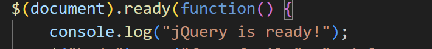

## Task 1. Selectors & CSS

I created the profile section with the title "Welcome to My Portfolio!", my name, a headline and a short introduction. I used a tag selector (`body`, `section`), an ID selector (`#name`) and a class selector (`.headline`) together with `.css()` to change fonts, colors and sizes. The Change Greeting button changes the title with `.text()`. The Light Theme and Dark Theme buttons use `.css()` to change the background and text color of the page and the sections.

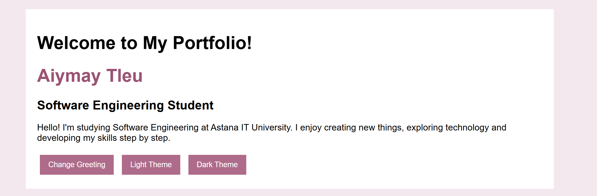

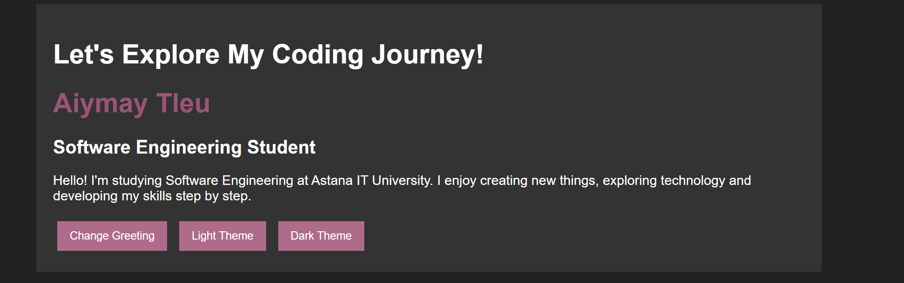

## Task 2. Visibility Methods

I created the About Me section with my biography, my current status and a list of facts about me. I put the status and the list into one `#info` block. The Hide, Show and Toggle buttons control this block with `.hide()`, `.show()` and `.toggle()`.

**Screenshots:**

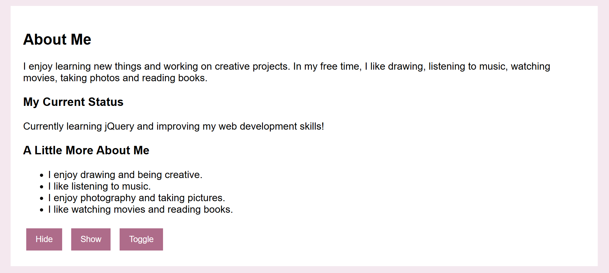

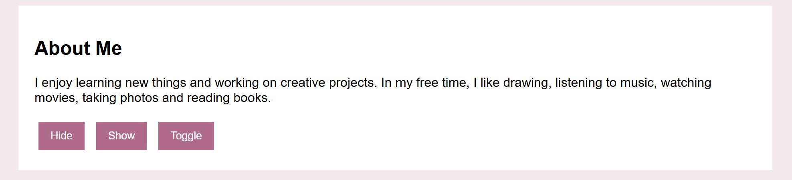

## Task 3. Fade Methods

I made a gallery with two pictures. Each picture has a title and a short description. The Fade In, Fade Out and Fade Toggle buttons use `.fadeIn()`, `.fadeOut()` and `.fadeToggle()` to show and hide the gallery items with a smooth effect.

**Screenshots:**

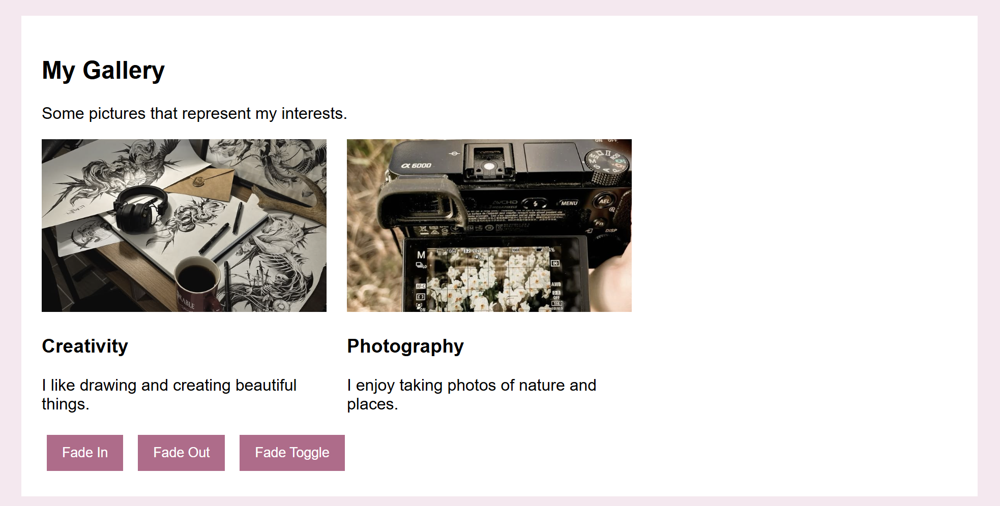

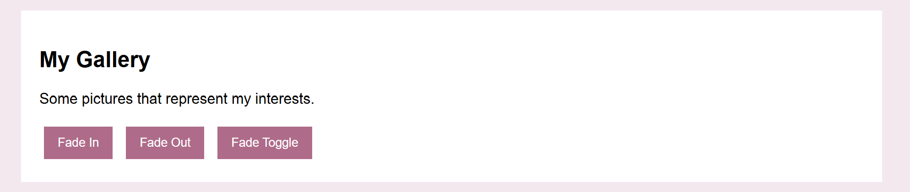

## Task 4. Slide Methods

I made three headings: My Favorite Music, My Favorite Movie and My Favorite Subject. Each heading has a panel with information, and at the beginning all panels are hidden. A click on a heading opens its panel with `.slideDown()`. A double click closes it with `.slideUp()`. A right click (the `contextmenu` event) opens or closes it with `.slideToggle()`.

**Screenshots:**

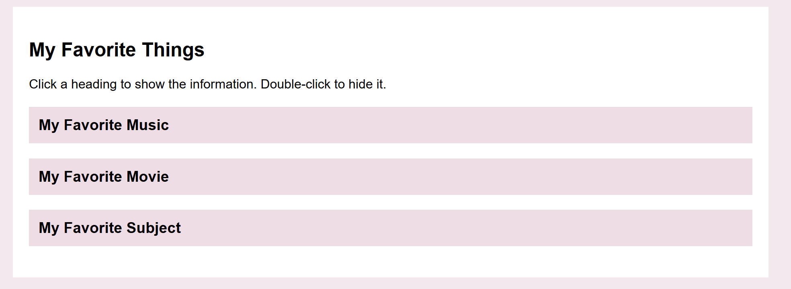

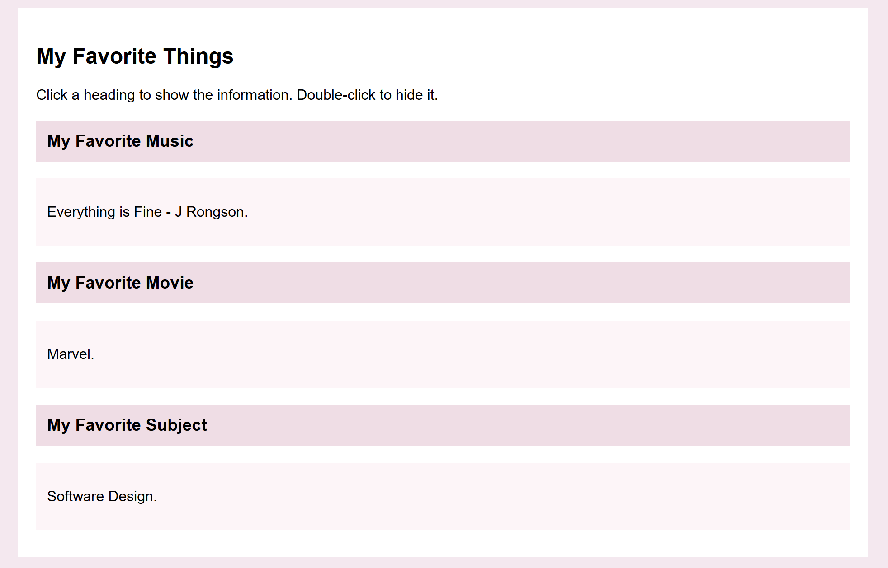

## Task 5. Add & Remove Elements

I made a list of technical skills: HTML, CSS, Java and Python. There is an input field and three buttons. Add Skill uses `.appendTo()` to add a new skill to the end of the list. Prepend Skill uses `.prependTo()` to add it to the beginning. Remove Skill uses `.remove()` to delete the last skill. I also added a check with `.trim()`, so an empty skill is not added, and a message is shown instead.

**Screenshots:**

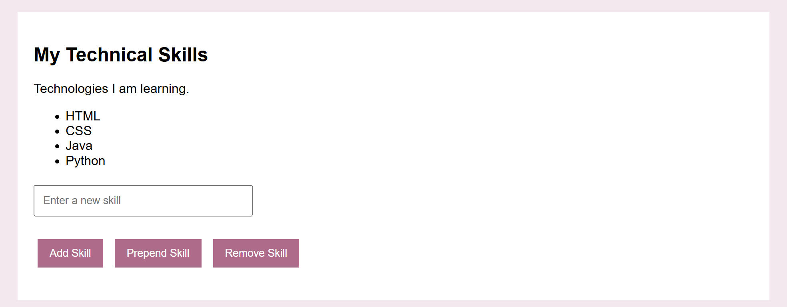

## Task 6. Modifying Attributes

I added a link to my GitHub profile. The button changes the link to my LinkedIn. I used `.attr()` to change the `href` attribute and `.text()` to change the text of the link.

**Screenshots:**

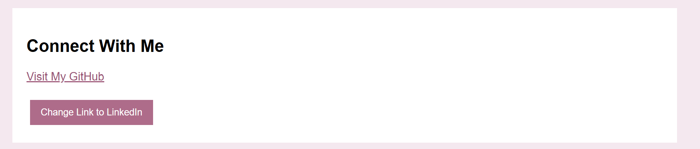

## Task 7. Form Interaction

I created a contact form with Name and Email fields. When the user types something, the text appears at once in the Live Preview block under the form. I used the `input` event, `.val()` to get the value of the field and `.text()` to show it on the page.

**Screenshots:**

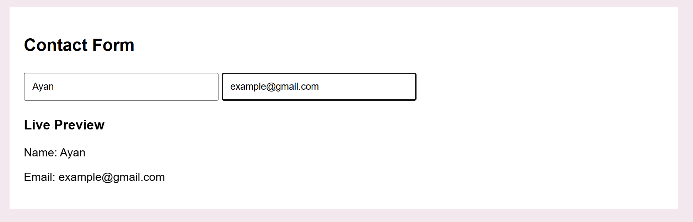

## Task 8. Basic Animation

I made skill bars for HTML, CSS, JavaScript and jQuery. At the start every bar has zero width. The Animate My Skills button uses `.animate()` to increase the width of each bar to its own level (90%, 80%, 65% and 40%). When I click the button again, the bars return to zero width. I used the `isAnimated` variable to remember the current state, and `.stop()` to stop the running animation before going back.

**Screenshots:**

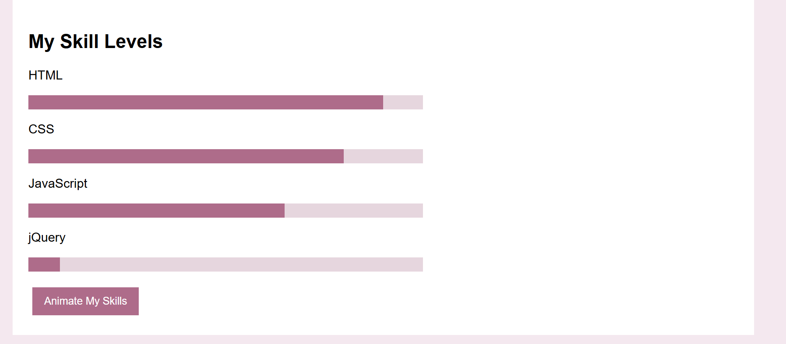

## Conclusion

In this assignment I learned how to use jQuery to make a website interactive. I practiced selectors, changing text, styles and attributes, and working with clicks, double clicks and typing. I used visibility, fade and slide effects, added and removed list items, and made skill bars with `.animate()`. jQuery helped me write shorter and simpler code than plain JavaScript.

